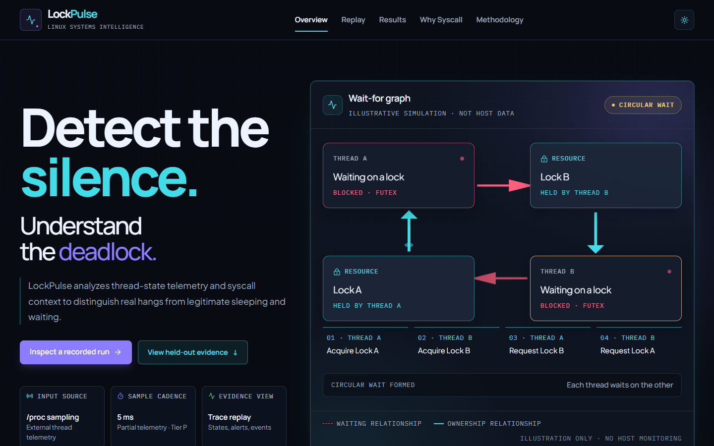

Live demo: https://lockpulse-pearl.vercel.app/

[](https://lockpulse-pearl.vercel.app/)

# LockPulse

LockPulse is a research prototype. It detects hangs (deadlocks, lost wakeups, barrier and semaphore hangs) in multithreaded C programs that use pthreads on Linux. It records two kinds of telemetry at the same time:

| Tier | What it is | Used for |
|---|---|---|
| **P** (partial) | An external sampler reads `/proc/<pid>/task/<tid>/{stat,status,syscall}` every 5 ms. Nothing runs inside the target. | The **only** input the ML model will ever see (later phases). |
| **F** (full) | An `LD_PRELOAD` shim (`liblockpulse.so`) logs every pthread mutex, condition-variable, semaphore and barrier call into a shared-memory trace file. | Ground-truth labels and an upper-bound baseline. **Never** a model input. |

A watchdog kills runs that stop making progress. The current phase is **4 (Evaluation and demo)**: the frozen phase-3 detectors evaluated once on the held-out test families, ablations, overhead, figures, a replay demo and the report ([results/phase4/REPORT.md](results/phase4/REPORT.md)). Phases 1–3 are complete. The full specification is [docs/LockPulse_Guide.md](docs/LockPulse_Guide.md), and the project rules are in [CLAUDE.md](CLAUDE.md).

## Requirements

- Linux x86-64 (WSL2 Ubuntu is fine), gcc, GNU make ≥ 3.82, Python 3 + pandas
  (`sudo apt-get install build-essential python3-pandas`).
- **Clone the repo to a path without spaces or `:`.** `LD_PRELOAD` cannot represent such paths, so `lp-run` refuses Tier F there. On WSL, use the Linux filesystem (`~/lockpulse`) rather than `/mnt/c/...`.
- CI is pinned to the `ubuntu-26.04` runner image, so all reported results come from one OS image.

## Build

```sh
make            # = make all: shim, launcher, 13 benchmarks, lp-dump, shim self-test
make clean      # removes build/ only; never touches data/
```

| Output | Built from |
|---|---|
| `build/liblockpulse.so` | `runtime/shim.c runtime/tracebuf.c` |
| `build/lp-run` | `launcher/*.c runtime/tracebuf.c` |
| `build/lp-dump` | `tools/lp-dump.c runtime/tracebuf.c` |
| `build/tests/shim_selftest` | `runtime/tests/shim_selftest.c` |
| `build/bench/<family>` | `bench/<family>.c bench/bench_common.h` |

CI builds with `EXTRA_CFLAGS=-Werror`. Run `make EXTRA_CFLAGS=-Werror` locally to reproduce it.

## Run one benchmark

```sh
./build/lp-run --family two_lock_inversion --run-id demo1 --tier PF --tag split=train \
    -- ./build/bench/two_lock_inversion --threads 2 --work-ms 400 --force 1 --seed 1
# lp-run: run=demo1 family=two_lock_inversion tier=PF exit=watchdog_kill duration_ms=3512.3 samples=...

./build/lp-dump data/raw/tierF/demo1.bin > data/processed/tierF/demo1.csv
./build/lp-dump --info data/raw/tierF/demo1.bin      # header, incl. glibc symbol resolution
```

`lp-run` takes these options:

| Option | Default | Meaning |
|---|---|---|
| `--tier P\|F\|PF` | `PF` | Which telemetry tiers to record. |
| `--interval-ms` | 5 | Tier P sampling period. |
| `--watchdog-ms` | 3000 | Kill the run after this long without a progress event (needs Tier F). |
| `--max-ms` | 10000 | Hard cap on run time, enforced for every tier. |
| `--data-dir` | `data/raw` | Where the run's raw files go. |
| `--shim PATH` | `liblockpulse.so` next to `lp-run` | The shim to preload. |
| `--tag KEY=VALUE` | none | Repeatable. Stored in the metadata `tags` object. |

- `lp-run` exits 0 whenever the run was recorded, whatever the benchmark did; check `exit_reason` in the metadata. It exits 1 on launcher errors and 2 on bad usage.
- `lp-run` never reuses a run id: it refuses to overwrite existing raw data.

## Benchmark suite (13 families)

Every family accepts `--threads --cs-us --work-ms --rate --iters --seed`. Hang families also accept `--force 0|1`:

- `--force 1` (the default) uses barriers, semaphores or condition variables to guarantee the bug.
- `--force 0` leaves the interleaving to the scheduler. The run may or may not hang, and the oracle decides, not the template.

Seeds drive start offsets and work jitter, so different seeds give genuinely different traces. Each `bench/*.c` header documents what every flag means for that family. Healthy families run 1–4 s and never go 3 s without a progress event.

| Family | Split | Expected | Mechanism (forced variant) |
|---|---|---|---|
| `two_lock_inversion` | train | hang, deadlock | T0 holds A and T1 holds B; a barrier; then each requests the other lock. |
| `three_thread_cycle` | validation | hang, deadlock | Thread i holds L[i]; a barrier; then it requests L[(i+1)%3]. |
| `dining_philosophers` | test | hang, deadlock | Every philosopher takes its left fork; a barrier; then all take the right fork. |
| `lost_wakeup` | train | hang | Signals are sent before the waiters wait (barrier); `cond_wait` has no predicate. |
| `prodcons_missing_signal` | train | hang | The last item is put without a signal, after all consumers are waiting. |
| `barrier_mismatch` | validation | hang | An N-party barrier, but one thread leaves early. |
| `sem_never_posted` | test | hang | The poster exits before posting all items; workers block in `sem_wait`. |
| `high_contention` | train | healthy | 4–16 threads share one mutex at ~90 % utilisation for 1.5–3 s, with per-iteration think time; about 50k Tier F events per run. |
| `long_critical_section` | train | healthy, hard negative | One thread busy-holds a lock for 1.0–2.5 s while the others block. |
| `consistent_lock_order` | train (was validation until 2026-11-19) | healthy | 2–3 of L locks are always taken in the global order. |
| `sleeping_workers` | validation (was train until 2026-11-19) | healthy, hard negative | All threads `nanosleep` 1–2 s between two work phases. |
| `prodcons_correct` | validation | healthy | The same buffer as above, with predicate loops and a signal per item. |
| `blocked_on_io` | test | healthy, hard negative | Readers block in `read` on a pipe whose writer pauses 1–2 s. |

Run configurations are in [configs/phase2.json](configs/phase2.json):

- 4 configs per family × seeds 1–15 = 780 runs, `--max-ms 6000`.
- For hang families, c4 is the `--force 0` config.
- `--watchdog-ms` is 3000 everywhere except `long_critical_section` (4000), whose 2.5 s hold legitimately has no progress event.

[configs/phase1.json](configs/phase1.json) keeps the phase-1 gate's 4-family setup.

## Pipeline (phase 2)

```sh
make collect [FAMILY=lost_wakeup] [SEEDS=1-3]   # scripts/collect.py: lp-run (PF) + lp-dump, resumable
make labels                                      # ml/label.py -> data/processed/labels.csv
make review                                      # scripts/review_sample.py -> results/review.md
make overhead                                    # scripts/overhead.py -> results/overhead.csv
```

- **`collect.py`** uses deterministic run ids (`<family>-<config>-s<seed>`). It skips runs whose metadata exists, moves leftovers of interrupted runs to `data/raw/incomplete/`, tags each run with `split`, `config_id`, `kind` and `force`, and prints a per-family summary.
- **The collect workflow** (`.github/workflows/collect.yml`) is the real collector. It is manual only (Actions → collect → Run workflow) and runs one parallel job per family, uploading artifacts named `lockpulse-data-<family>`. It also runs an overhead job. A final job merges everything, labels it, writes the review sample and uploads two artifacts:
  - **`lockpulse-labels-and-reports`** (small): `labels.csv`, `labels_summary.txt`, `review.md`, `overhead.csv`, `overhead_runs.csv` and the per-family collect summaries. Download this one for the human gate.
  - **`lockpulse-data-all`** (full dataset, for model training): metadata JSON, Tier P and Tier F CSVs as `.csv.gz`, and labels. pandas reads `.csv.gz` directly, and so do `ml/label.py` and `scripts/review_sample.py`.

  The job summary lists every artifact's size.

  Raw Tier F `.bin` files are not uploaded (sparse 256 MiB files); their complete content is in `data/processed/tierF/*.csv.gz`. `scripts/pack_data.py` gzips staged copies of the raw Tier P CSVs, so the raw files themselves are never modified. Expect roughly 75 MB compressed (~530 MB as plain CSV) for all 780 runs. This is an upper bound estimated from the configs; `high_contention` (~25 MB gz), `consistent_lock_order` (~14 MB) and `prodcons_correct` (~10 MB) are the largest.
- **`overhead.py`** runs `high_contention` and `prodcons_correct` 10 times in each of 4 modes (untraced, P, F, PF). The benchmarks run in *fixed-work* mode (`--work-ms 0 --rate 0 --iters N`): a fixed number of operations with no time limit and no think time. The time-bounded collection mode always runs for `work_ms`, so it can't show overhead. The script reports the median and IQR of `bench_ms` and of ops/s, the slowdown versus untraced, and the launcher/sampler CPU %, which `lp-run` reads from its own `/proc/self/stat` at the end of the run. The phase-1 gate's overhead block uses the same mode.

## Reproduce every result from a fresh clone (no Linux needed)

Phases 3 and 4 are pure Python and run on Windows, macOS or Linux. The commands below use Windows paths; on Linux use `.venv/bin/python`.

1. **Get the code:**

   ```sh
   git clone https://github.com/Abo0wael/lockpulse.git && cd lockpulse
   ```

2. **Get the dataset** (collect run 44361187947, artifact `lockpulse-data-all`, about 52 MB unzipped). Use the GitHub CLI, or download it from the run's Actions page and unzip it to the same place:

   ```sh
   gh run download 44361187947 -n lockpulse-data-all -D data/collect1/lockpulse-data-all
   ```

   You should then have `data/collect1/lockpulse-data-all/data/{raw,processed}` and `.../results/`.

3. **Re-label once.** The artifact predates the 2026-11-19 split fix, so this updates the split column from `configs/phase2.json`:

   ```sh
   python -m venv .venv
   .venv/Scripts/python -m pip install -r requirements-ml.txt
   .venv/Scripts/python ml/label.py --raw data/collect1/lockpulse-data-all/data/raw --processed data/collect1/lockpulse-data-all/data/processed
   ```

4. **Run everything:**

   ```sh
   .venv/Scripts/python -m ml.freeze check     # the frozen detectors are intact
   .venv/Scripts/python -m ml.phase4           # all phase-4 tables + figures (~50 s)
   make reproduce                              # or: also retrain phase 3 from raw traces and check it
                                               # reproduces the frozen models byte for byte (~3 min)
   .venv/Scripts/python -m demo.replay dining_philosophers-c1-s01   # replay demo (see demo/DEMO.md)
   ```

`make all` stays the C build that CI uses; the ML pipeline is `make reproduce` (phase 3 then phase 4), plus `make phase4` and `make demo RUN=<run_id>`.

## Website

The website (Next.js, static export, deployed on Vercel) presents the frozen phase-4 results and replays recorded runs. The source is in [web/](web/); its last audit is [web/AUDIT.md](web/AUDIT.md).

| Page | What it shows |
|---|---|
| `/` | Overview: the problem (a quiet CPU is not a diagnosis), the pipeline, and the headline held-out test numbers. |
| `/replay` | One recorded run, tick by tick. Shows: a per-thread timeline (running / futex / sleep-IO / not alive per 5 ms tick) with the t0 marker and every detector's alert; the M3 score with its frozen threshold; B2 futex silence with T; thread states and syscalls; detector scores; the Tier F wait-for graph; sync events. The run picker lists test runs first. `?run=<id>&t=<ms>` links to a moment. |
| `/results` | Detector comparison (B1–B4, M1–M3) on the test or validation split, delays, false alarms, per-family results. |
| `/why-syscall` | Why syscall context matters, with the feature ablation (M2/M3 drop from 91/91 to 0/91 without syscall features). |
| `/method` | Dataset, tiers, features, detectors, evaluation protocol, overhead and limitations. `/methodology` redirects here. |

All numbers come from static JSON in `web/public/data/`, produced from the frozen detectors and the committed result tables. To rebuild it (needs the dataset in `data/collect1/`, step 2 of the reproduce section above; it verifies the frozen model hashes first and only reads results):

```sh
.venv/Scripts/python -m ml.export_web          # writes web/public/data/ (~4 MB)
```

To run the site locally (Node.js 20+):

```sh
cd web
npm ci
npm run dev        # http://localhost:3000
npm run build      # static export to web/out/ (what Vercel serves)
```

Pushing to `main` redeploys the site on Vercel.

## Phase 4: evaluation and demo

- **Freeze:** `results/phase4/FROZEN.md` / `frozen.json` hold the SHA-256 of the phase-3 settings and models (committed). `ml.freeze` verifies them, phase 4 loads nothing else, and `ml.phase3` refuses to overwrite `results/phase3/`.
- **Test evaluation:** `python -m ml.evaluate --split test --final` was run once. Its log, time and code commit are in `results/phase4/NOTES.md`. The output is `test_table.md`/`.csv`, overall and per test family.
- **Ablations:** `ablation_table.md`. Feature groups for M2/M3, and sampling interval 5/10/20 ms for M2/M3/B2. Every choice is made on validation; the numbers are reported on test.
- **Overhead:** `overhead_table.md`, copied from the collect artifact (no new runs).
- **Figures:** `results/phase4/figures/` (delay box plot, false alarms by family, overhead, a hang-run timeline).
- **Demo:** `python -m demo.replay <run_id> [--speed 1.0]` replays a recorded run with the frozen detectors and shows thread states, the M3 score, B2 silence, B3 cycles, alerts, the ground truth and delays. The 5-minute script is `demo/DEMO.md`.
- **Report:** `results/phase4/REPORT.md`.

## Phase 3: features, baselines and models

Phase 3 is pure Python and runs on any OS, Windows included:

```sh
make venv        # .venv with the pinned requirements-ml.txt (numpy, pandas, scikit-learn, joblib)
make phase3      # = python -m ml.phase3: features -> baselines -> train -> evaluate (about 2.5 min)
make test-ml     # unit tests (also in CI, job ml-tests)
```

- **Input:** the collected dataset. `data/collect1/lockpulse-data-all/data` is used if it exists, else `data/`; pass `--data` to choose another.
- **Features:** `data/processed/features_W{10,20,40}.csv.gz`.
- **Results:** `results/phase3/`:
  - `validation_table.md` / `.csv`: the phase-3 gate table;
  - `chosen.json`: every chosen setting, versions and runtime;
  - `model_search.csv` and `baseline_sweeps.csv`: every candidate on validation;
  - `feature_importance.csv`;
  - `train_table.md`: diagnostic only;
  - `NOTES.md`: what was chosen and why, surprises, and where the models lose;
  - `models/*.joblib`: gitignored.

| Module | Role |
|---|---|
| `ml/features.py` | Tier P → one row per sampler tick, trailing-window features (W ∈ {10, 20, 40} ticks). Causal, warm-up skipped, label y = tick ≥ t0. |
| `ml/baselines.py` | B1 CPU-silence timeout, B2 all-futex silence (Tier P); B3 wait-for cycle, B4 progress watchdog (Tier F). |
| `ml/train.py` | M1 logistic regression, M2 random forest, M3 gradient boosting. Fitted on train runs; W, hyperparameters and threshold chosen on validation. |
| `ml/evaluate.py` | Alert policy (3 consecutive ticks, first alert counts), run-level metrics, the threshold rule (max detection s.t. false alarms ≤ 5 %, then lower median delay), the test-split guard. |
| `ml/phase3.py` | End-to-end runner and tables. |

- **Rules:**
  - The test split is never used in phase 3: `python -m ml.evaluate --split test` refuses without `--final` (phase 4).
  - Model inputs are Tier P features only.
  - Ambiguous runs are excluded everywhere.
  - Random seeds are fixed.

## Gates

```sh
make clean && make check-phase1   # phase-1 gate (4 families, 3 seeds; unchanged)
make check-shim                   # shim self-test only
make check-phase2                 # phase-2 gate, < 5 min
make test-ml                      # oracle unit tests
```

`check-phase2` ([scripts/check_phase2.py](scripts/check_phase2.py)) does the following:

1. Builds everything.
2. Runs the shim self-test untraced and under the shim. The traced run must produce the exact event counts the program prints.
3. Checks the shim's bookkeeping in that trace:
   - every blocking call is closed;
   - every cond wait has an implicit mutex REL/ACQ pair;
   - `pthread_cond_*` resolved with `dlvsym` at `GLIBC_2.3.2`, and `sem_*`/barrier with `dlvsym`.
4. Checks that `lp-dump` still reads a schema-v1 trace.
5. Runs config c1, seed 1 of all 13 families and labels them. It asserts:
   - every forced hang has hang=1;
   - every healthy family has `exited_ok` and hang=0;
   - deadlock=1 exactly for the three mutex-cycle families;
   - no run is ambiguous.
6. Runs `ml/tests`.

The full phase-2 gate is human. In the `lockpulse-data-all` artifact, ambiguous runs must be under 5 %, and the 10 runs in `results/review.md` must be checked by hand.

Gate runs write to `data/raw/gate/` and `data/processed/gate/`, and overhead runs to `data/raw/overhead/`, so neither mixes with the dataset.

## Data layout and file formats

```
data/raw/meta/<run_id>.json        run metadata                 (raw, immutable)
data/raw/tierP/<run_id>.csv        Tier P samples               (raw, immutable)
data/raw/tierF/<run_id>.bin        Tier F trace buffer          (raw, immutable)
data/processed/tierF/<run_id>.csv.gz  lp-dump output, gzipped (derived; gates keep plain .csv)
data/processed/labels.csv          oracle labels                (derived)
```

Both tiers timestamp with `CLOCK_MONOTONIC` in nanoseconds, so they can be compared directly.

### Tier P CSV: `ts_ns,tid,state,utime_ticks,stime_ticks,vcsw,nvcsw,syscall_nr`

| Column | Meaning |
|---|---|
| `ts_ns` | Start of the sampling tick. All rows of one tick share it and form one snapshot. |
| `tid` | Kernel thread id. |
| `state` | `stat` field 3: `R` running, `S` sleeping, `D` disk wait, `Z` zombie, `T`/`t` stopped, ... |
| `utime_ticks`, `stime_ticks` | `stat` fields 14/15: user and system CPU time, in clock ticks (usually 100/s). |
| `vcsw`, `nvcsw` | `voluntary_ctxt_switches` / `nonvoluntary_ctxt_switches` from `status` (cumulative). |
| `syscall_nr` | First field of `syscall`. A value ≥ 0 is the x86-64 syscall the thread is blocked in (202 futex, 0 read, 230 clock_nanosleep). `-1` running, `-2` unreadable, `-3` the kernel reported `-1` (blocked, not in a syscall). |

### Tier F trace (`.bin`, schema v2; see [runtime/tracebuf.h](runtime/tracebuf.h))

The file is a 4096-byte header followed by one region per thread (64 threads × 131072 records). Each region is a 64-byte region header (atomic `count`, owner `tid`) followed by 32-byte records.

- **Header fields:**
  - `magic "LPTR"`, `schema_version`, `max_threads`, `records_per_thread`, `header_size`, `record_size`, `region_size`;
  - `progress_counter`: incremented on every progress event (below);
  - `next_slot`;
  - `overflow`: bit 0 = records dropped, bit 1 = more than 64 threads;
  - `dropped_records`, `created_ns`;
  - `resolve_how[16]`: how each interposed function was resolved (v2).
- **Record (32 bytes, naturally aligned):** `u64 ts_ns`, `u64 wait_ns`, `u64 obj_addr`, `u32 tid`, `u16 event`, `u16 site`.
- **Schema v1 (phase 1)** had mutex events only and 65536 records per thread. `lp-dump` reads both versions.

The file is created sparse and mapped `MAP_SHARED`, so every complete record survives the target being SIGKILLed.

### Tier F CSV (`lp-dump`): `ts_ns,tid,event,obj_addr,wait_ns,site`

All threads are merged and sorted by `ts_ns`.

| Call | Events |
|---|---|
| `pthread_mutex_lock` | `MUTEX_REQ`, then `MUTEX_ACQ` (`wait_ns` = blocked time) or `ERROR` |
| `pthread_mutex_trylock` | `MUTEX_ACQ`, `MUTEX_TRYLOCK_FAIL` or `ERROR` |
| `pthread_mutex_unlock` | `MUTEX_REL` or `ERROR` |
| `pthread_cond_wait`, `pthread_cond_timedwait` | `COND_WAIT_ENTER` + implicit `MUTEX_REL`; on return, implicit `MUTEX_ACQ` + `COND_WAIT_EXIT` (or `ERROR`, e.g. ETIMEDOUT) |
| `pthread_cond_signal`, `pthread_cond_broadcast` | `COND_SIGNAL`, `COND_BROADCAST` or `ERROR` |
| `sem_wait`, `sem_timedwait` | `SEM_WAIT_ENTER`, then `SEM_WAIT_EXIT` or `ERROR` (errno) |
| `sem_trywait` | `SEM_WAIT_EXIT`, `SEM_TRYWAIT_FAIL` (EAGAIN) or `ERROR` |
| `sem_post` | `SEM_POST` or `ERROR` |
| `pthread_barrier_wait` | `BARRIER_ENTER`, then `BARRIER_EXIT` or `ERROR` |
| any thread | `THREAD_FIRST_SEEN` on its first logged call |

- **Progress events:** `MUTEX_ACQ`, `MUTEX_REL`, `COND_SIGNAL`, `COND_BROADCAST`, `COND_WAIT_EXIT`, `SEM_POST`, `SEM_WAIT_EXIT`, `BARRIER_EXIT`. Implicit cond mutex events count too.
- **`obj_addr`:** sync object address in hex.
- **`wait_ns`:** ns since the matching request or enter; for `ERROR`, the error code.
- **`site`:** 0 for an explicit call, 65535 for the implicit mutex release/re-acquire inside `pthread_cond_[timed]wait`.

`lp-dump` exits 0 when the trace is OK, 3 when the buffer overflowed (the CSV is still written), 2 for an invalid file and 1 for usage or I/O errors.

### Metadata JSON (`meta/<run_id>.json`, schema 2)

| Field | Contents |
|---|---|
| `run_id`, `family`, `bench_argv`, `params` | Every `--key value` passed to the benchmark. |
| `seed`, `tags` | `tags` comes from `--tag`; collection sets `split`, `config_id`, `kind`, `force`. |
| `tier`, `interval_ms`, `watchdog_ms`, `max_ms`, `pid` | Run settings. |
| `start_ns`, `exec_ns`, `end_ns`, `duration_ms` | `start_ns` is before fork, `exec_ns` is after a successful exec, `end_ns` is after reaping. |
| `exit_reason` | `exited_ok`, `exited_error(<code>)`, `signaled(<sig>)`, `watchdog_kill` or `max_time_kill`. |
| `exit_code`, `term_signal`, `killed_by`, `kill_ns`, `exec_errno` | Details of how the run ended. |
| `tierP` | `{path, samples, ticks, syscall_reads_ok, syscall_reads_unreadable}`, or `null`. |
| `tierF` | `{path, mapped, progress_counter, last_progress_observed_ns, overflow, overflow_flags, dropped_records, threads_seen, max_threads, records_per_thread}`, or `null`. |
| `launcher_cpu` | `{utime_ticks, stime_ticks, clk_tck, ru_user_us, ru_sys_us, cpu_pct}`: lp-run's own CPU (sampler + watchdog). |
| `env` | `{uname, gcc_version (of the compiler that built lp-run), glibc_version, yama_ptrace_scope, runner}`. `runner` holds `ImageOS`, `ImageVersion`, `RUNNER_*` and `GITHUB_*` values when set. |
| `warnings` | For example: `/proc/<tid>/syscall` unreadable, or an empty Tier F trace. |

### Labels (`data/processed/labels.csv`)

Columns: `run_id, family, split, config_id, seed, force, exit_reason, hang, t0_ns, deadlock, ambiguous, reason`. The rules are in the [ml/label.py](ml/label.py) docstring:

- **`exited_ok`:** hang=0.
- **`watchdog_kill`:** t0 = the last progress event. hang=1 if every live thread stays blocked from t0 on, either:
  - with a pending Tier F wait (`MUTEX_REQ`, `COND_WAIT_ENTER`, `SEM_WAIT_ENTER` or `BARRIER_ENTER` not closed by its exit event or `ERROR`), or
  - with no pending Tier F wait, if Tier P shows it in state S or D with no CPU time gained since t0 (for example, main in `pthread_join`).
- **deadlock=1:** hang=1 and the final mutex wait-for graph has a cycle. `reason` names the cycle's tids and mutexes.
- **ambiguous=1** (and hang=0) when:
  - the run was a `watchdog_kill` but not all live threads were blocked;
  - `max_time_kill`;
  - the run ended by signal or with an error exit;
  - the trace buffer overflowed;
  - data is missing.

Ambiguous runs are excluded from training later. Tier P is used here for labels only, never as a feature.

## How the team works

- **One branch per component**, named with the component's prefix below (`docs/...` for shared docs).
- **Open a pull request into `main`.** The `ci` workflow runs `make check-phase1` and `make check-phase2` with `-Werror` on `ubuntu-26.04`. Both must pass before merging; no direct pushes to `main` once branch protection is on.
- **Use the artifacts to inspect runs without Linux.** CI uploads `phase1-data-<n>` and `phase2-gate-<n>`, and the collect workflow uploads `lockpulse-data-*`.
- **Edit only files your component owns.** If you must change another component's file, say so in the PR and request that owner's review.

| Owner | Branch prefix | Owns |
|---|---|---|
| Runtime | `runtime/` | `runtime/shim.c`, `runtime/tracebuf.c`, `runtime/tracebuf.h`, `tools/lp-dump.c`, `runtime/tests/shim_selftest.c` |
| Benchmarks A (hang families) | `bench-hang/` | `bench/two_lock_inversion.c`, `bench/three_thread_cycle.c`, `bench/dining_philosophers.c`, `bench/lost_wakeup.c`, `bench/prodcons_missing_signal.c`, `bench/barrier_mismatch.c`, `bench/sem_never_posted.c` |
| Benchmarks B (healthy families + configs) | `bench-healthy/` | `bench/high_contention.c`, `bench/long_critical_section.c`, `bench/consistent_lock_order.c`, `bench/sleeping_workers.c`, `bench/prodcons_correct.c`, `bench/blocked_on_io.c`, `configs/phase2.json`, `configs/phase1.json` |
| Oracle | `oracle/` | `ml/label.py`, `ml/tests/test_label.py` |
| Collection | `collect/` | `scripts/collect.py`, `scripts/overhead.py`, `scripts/review_sample.py`, `scripts/check_phase2.py`, `scripts/lpkit.py`, `scripts/check_phase1.py`, `.github/workflows/collect.yml`, `.github/workflows/ci.yml`, `launcher/*` |
| Phase 3: features | `ml-features/` | `ml/features.py`, `ml/tests/test_features.py` (incl. the leakage tests) |
| Phase 3: baselines | `ml-baselines/` | `ml/baselines.py`, `ml/tests/test_baselines.py` |
| Phase 3: models | `ml-train/` | `ml/train.py`, `requirements-ml.txt` |
| Phase 3: evaluation | `ml-eval/` | `ml/evaluate.py` (alert policy, threshold rule, tables), `ml/tests/test_evaluate.py` |
| Phase 4: freeze, test evaluation, ablations | `ml-eval/` | `ml/freeze.py`, `ml/ablations.py`, `ml/phase4.py`, `results/phase4/` tables |
| Phase 4: figures, demo, report | `ml-runner/` | `ml/figures.py`, `ml/runview.py`, `demo/`, `results/phase4/REPORT.md` |
| Phase 3: runner and CI | `ml-runner/` | `ml/phase3.py`, `ml/__init__.py`, `results/phase3/NOTES.md`, the `ml-tests` job in `.github/workflows/ci.yml`, the `venv`/`phase3`/`test-ml` Makefile targets |
| Shared (any change needs two reviewers) | `docs/` | `Makefile`, `README.md`, `CLAUDE.md`, `docs/`, `bench/bench_common.h`, `.gitignore`, `.gitattributes` |

`runtime/tracebuf.h` is the contract between the shim, the watchdog, `lp-dump` and `ml/label.py`. Any layout or event change must bump `LP_SCHEMA_VERSION`, keep `lp-dump` reading older versions, and update the format section above and `PROGRESS_EVENTS` in `ml/label.py` in the same PR.
